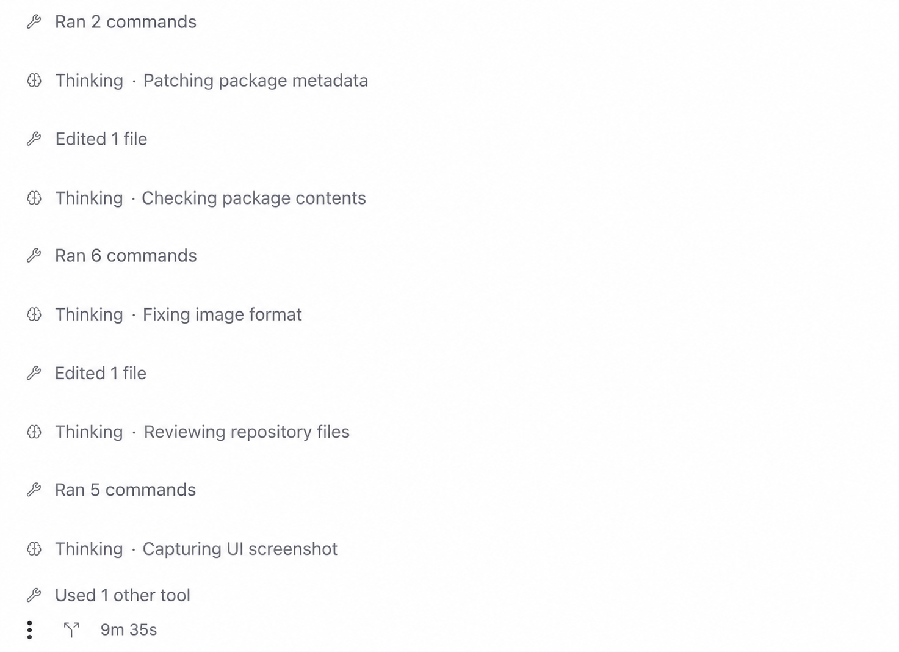

# paseo-thinking

A Paseo plugin that shows the latest bold thinking summary for Codex and an estimate of visible thinking tokens for Claude. Codex blocks start collapsed; Claude blocks start expanded. Successful turns collapse their thinking blocks. You can toggle each block afterward.



## Compatibility

Requires Paseo 0.11.4 or later, with plugins enabled. No core changes are needed. The plugin supplies its own thinking renderer and does not read Paseo's built-in thinking expansion preference.

## Install

Enable plugins in Paseo, then install from GitHub or npm:

```sh
paseo plugin install github:dmeledon/paseo-thinking
paseo plugin install npm:paseo-thinking@0.1.0
```

The GitHub and npm sources are alternative ways to install the same plugin. Use the registry listing once the plugin has been accepted into the Paseo plugin hub.

## Limitations

- The Claude count estimates displayed text length divided by four. It is not billable usage or hidden reasoning-token usage, and accuracy varies by language and content.
- The plugin remembers successful turns in the daemon's memory. Reloading the plugin or restarting the daemon clears those results; older rows then use their provider's default expansion state.
- This plugin replaces Paseo's thinking rows. Disable another plugin that claims reasoning rows, such as `inline-thinking`, before enabling it. It does not read Paseo's built-in thinking expansion preference.
- Thinking text is plain selectable text. Long blocks follow new text until you scroll away from the bottom, and resume following when you return to it.

## Development

For local development, run:

```sh
npm ci
npm run typecheck
npm test
npm run lint
paseo plugin install /absolute/path/to/paseo-thinking
```

After editing source, run `paseo plugin reload thinking`. Do not restart the daemon to reload a plugin.

## How it works

- While a turn is active, mounted thinking rows poll outcomes once per second, sharing a query cache and in-flight requests. A successful outcome triggers a paginated read of its recorded thinking rows before they collapse.
- Turn IDs and recorded row timestamps identify the thinking belonging to a successful turn. Missing outcomes are never assumed to mean success.
- Providers must distinguish adjacent turns with different IDs; the plugin reads the latest contiguous group with the completed turn's ID.
- A temporary timeline read error is retried before giving up. Success keys for the 100 most recently closed agents remain available to history views.
- Client UI uses React Native primitives, theme colors, keyboard-accessible buttons, selectable text, and the host's streamed-text reveal hook.
- Styling follows Paseo's built-in thinking badge: compact header, brain/disclosure icon, attached bordered details, and normal body typography. Codex shows the latest text inside `**` beside Thinking; Claude shows the approximate token count there.
- The detail area grows with its text up to the default 400-pixel maximum, then scrolls inside that height. The plugin uses Paseo's default platform font stack; custom app typography settings are not exposed by the plugin API.

See [OVERVIEW.md](OVERVIEW.md) for the in-app description.
